  

  

  
  
  

  

   
   
  

<table align="center">
<tr>
<td align="center" width="760">

 

<h3>🌐 x0dex</h3>

<!-- коротко о сайте: что это и для кого -->

ОПИСАНИЕ САЙТА — что это за проект и для кого

  
  
  
  

  

</td>
</tr>
</table>

  

  
  

  <code>x0dex@prod:~$ exit</code>

